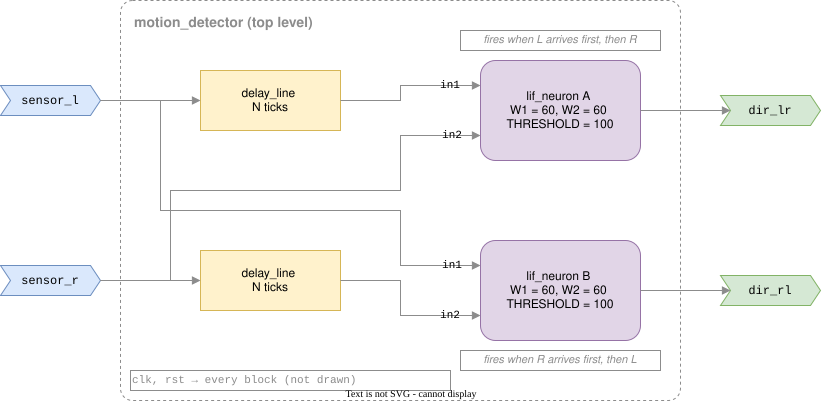

# neuro-silicon: Specification

## Purpose

A tiny neuromorphic chip that detects the **direction of motion** between two sensors.
An object passing **left → right** makes `dir_lr` spike; **right → left** makes `dir_rl` spike.

## Pins

| Pin        | Dir | Width | Description                         |
|------------|-----|-------|-------------------------------------|
| `clk`      | in  | 1     | System clock                        |
| `rst`      | in  | 1     | Synchronous reset, active high      |
| `sensor_l` | in  | 1     | Spike from the left sensor          |
| `sensor_r` | in  | 1     | Spike from the right sensor         |
| `dir_lr`   | out | 1     | Spike: motion detected left → right |
| `dir_rl`   | out | 1     | Spike: motion detected right → left |

## Block diagram

Each sensor wire feeds two places. A neuron fires only when its two inputs
arrive (almost) together; the delay makes that happen only for one direction.

## Blocks

### `lif_neuron` (rtl/lif_neuron.sv)

- Leaky integrate-and-fire, 2 weighted spike inputs
- Membrane potential `v`: 8-bit unsigned (0..255)
- Leak: `v >> 3` (v/8) per tick
- Threshold: `THRESHOLD` (default 100)
- Weights: `W1`, `W2` (default 60 each: one alone stays below threshold, both together fire)
- On fire: `spike` = 1 for one tick, `v` resets to 0

### `delay_line` (rtl/delay_line.sv)

- Delays a 1-bit spike by `N` ticks
- Status: not started

### `motion_detector` (rtl/motion_detector.sv)

- Top level: 2 × `lif_neuron` + 2 × `delay_line`
- Status: not started

## Open questions

- `N` (delay): depends on sensor spacing and object speed
- Coincidence window: how far apart can the two spikes be and still count as "together"?
